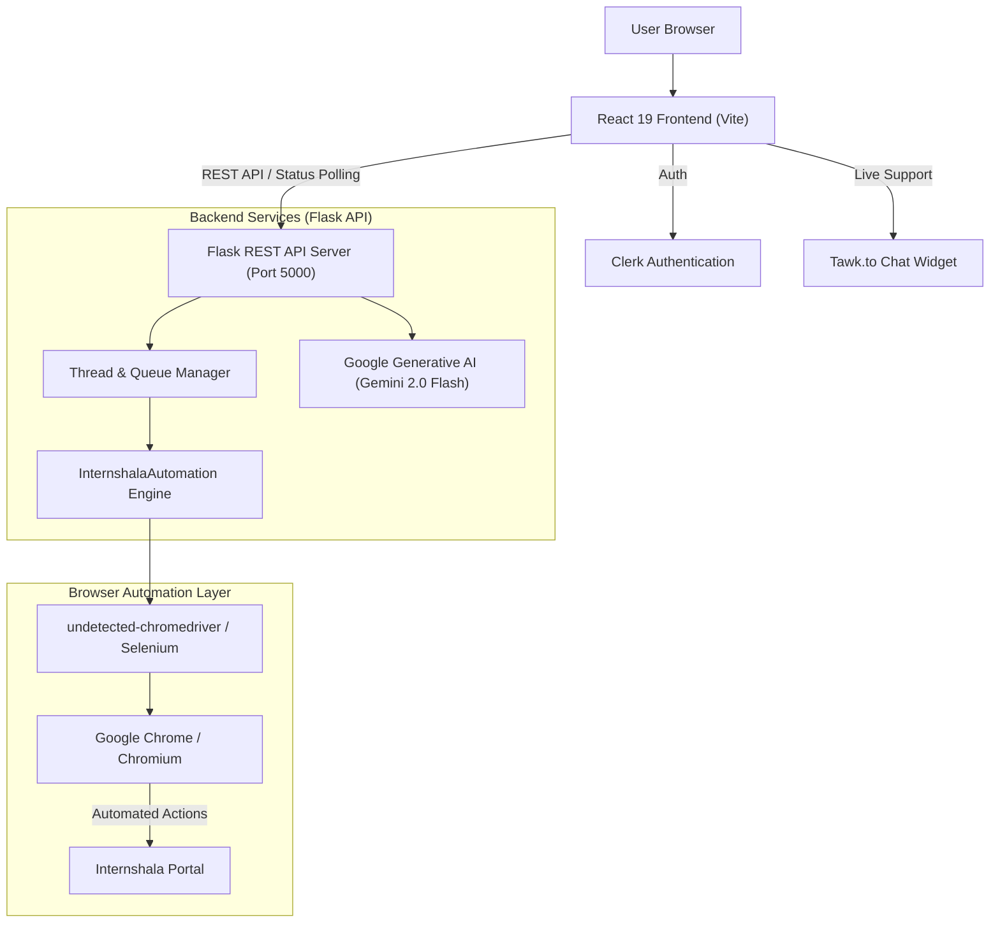

# InternAuto — Project Documentation

**InternAuto** is an all-in-one career acceleration and job automation platform. It combines automated internship applications on Internshala, AI-driven career roadmapping via Google Gemini, and an interactive resume builder with client-side document export.

---

## Table of Contents
1. [System Architecture](#system-architecture)
2. [Tech Stack](#tech-stack)
3. [Repository Directory Structure](#repository-directory-structure)
4. [Core Features & Modules](#core-features--modules)
   - [1. Internshala Application Automation](#1-internshala-application-automation)
   - [2. AI Career Guidance Engine](#2-ai-career-guidance-engine)
   - [3. Interactive Resume Builder](#3-interactive-resume-builder)
   - [4. User Authentication & Support](#4-user-authentication--support)
5. [API Specification](#api-specification)
6. [Environment Configuration](#environment-configuration)
7. [Local Setup & Running Instructions](#local-setup--running-instructions)
8. [Docker & Containerized Deployment](#docker--containerized-deployment)
9. [Troubleshooting & Best Practices](#troubleshooting--best-practices)

---

## System Architecture



---

## Tech Stack

### Frontend
- **Framework**: [React 19](file:///d:/Projects/InternAuto_project/frontend/package.json), [Vite 6](file:///d:/Projects/InternAuto_project/frontend/vite.config.js)
- **Routing**: [react-router-dom v7](file:///d:/Projects/InternAuto_project/frontend/src/App.jsx)
- **Styling**: [Tailwind CSS v4](file:///d:/Projects/InternAuto_project/frontend/src/index.css), CSS Variables, Glassmorphism
- **Animations**: [framer-motion](https://www.framer.com/motion/), [typewriter-effect](https://github.com/tameemsafi/typewriter-effect)
- **Authentication**: [@clerk/clerk-react](file:///d:/Projects/InternAuto_project/frontend/src/main.jsx)
- **Document Export**: [jspdf](https://github.com/parallax/jsPDF) (PDF), [docx](https://docx.js.org/) & [file-saver](https://github.com/eligrey/FileSaver.js/) (DOCX)
- **UI Notifications**: [react-hot-toast](https://react-hot-toast.com/)
- **Live Chat**: [Tawk.to](file:///d:/Projects/InternAuto_project/frontend/src/components/TawkToChat.jsx)

### Backend
- **Language & Runtime**: Python 3.11+
- **Web Framework**: [Flask](file:///d:/Projects/InternAuto_project/backend/api.py), Flask-CORS
- **AI Integration**: [google-generativeai](file:///d:/Projects/InternAuto_project/backend/requirements.txt) (`gemini-2.0-flash`)
- **Web Scraping & Automation**:
  - `selenium` (>= 4.10.0)
  - `undetected-chromedriver` (== 3.5.4)
  - `webdriver-manager` (>= 3.8.6)
- **Logging & Job Management**: Python standard library `queue.Queue`, `threading`, and file handlers (`api.log`, `internshala_auto.log`)

### Infrastructure & Deployment
- **Containerization**: Multi-stage [Dockerfile](file:///d:/Projects/InternAuto_project/Dockerfile) (Node.js build stage + Python 3.11 Chromium runtime)
- **Orchestration**: [docker-compose.yml](file:///d:/Projects/InternAuto_project/docker-compose.yml)
- **PaaS Deployment**: [render.yaml](file:///d:/Projects/InternAuto_project/backend/render.yaml) for Render web services

---

## Repository Directory Structure

```plaintext
InternAuto_project/
├── .dockerignore                 # Excluded files for Docker builds
├── Dockerfile                    # Multi-stage Docker build file
├── docker-compose.yml            # Docker Compose service definition
├── README.md                     # High-level repository summary
├── DOCUMENTATION.md              # Complete system technical documentation
├── backend/
│   ├── .env                      # Environment secrets (API keys & default credentials)
│   ├── api.py                    # Flask API endpoints & background job worker
│   ├── api_server.log            # Server execution logs
│   ├── chrome_finder.py          # OS-specific Google Chrome executable locator
│   ├── chromedriver_manager.py   # Driver cache cleaner & version resolver
│   ├── config.py                 # Configuration and environment loaders
│   ├── direct_chrome_driver.py   # Fallback vanilla Selenium driver builder
│   ├── fallback_run.py           # Standalone fallback automation runner
│   ├── internshala_auto.py       # Core automation engine (InternshalaAutomation)
│   ├── render.yaml               # Render cloud deployment blueprint
│   ├── requirements.txt          # Python dependencies
│   ├── run.py                    # CLI entrypoint for automation
│   ├── run_api_server.py         # Entrypoint script for Flask server
│   └── error_screenshots/       # Directory storing debug screenshots
└── frontend/
    ├── .env.example              # Sample frontend environment config
    ├── eslint.config.js          # ESLint configuration
    ├── index.html                # Single-page HTML entry point
    ├── package.json              # NPM package configurations & scripts
    ├── vite.config.js            # Vite build configuration
    └── src/
        ├── App.jsx               # Main React router & landing page view
        ├── main.jsx              # Clerk provider & DOM mount root
        ├── index.css             # Tailwind base styles and themes
        ├── api/
        │   └── index.js          # Frontend HTTP client with backup failover
        └── components/
            ├── AutomationStatus.jsx  # Real-time job monitor and log visualizer
            ├── CareerForm.jsx        # Gemini AI career recommendation modal
            ├── ErrorBoundary.jsx     # Global UI fallback handler
            ├── InternshalaForm.jsx   # Credentials submission & launch form
            ├── ResumeForm.jsx        # Multi-step resume generator & exporter
            ├── StatusBadge.jsx       # Status indicator component
            └── TawkToChat.jsx        # Tawk.to live support integration
```

---

## Core Features & Modules

### 1. Internshala Application Automation
- **Source File**: [internshala_auto.py](file:///d:/Projects/InternAuto_project/backend/internshala_auto.py)
- **Class**: [`InternshalaAutomation`](file:///d:/Projects/InternAuto_project/backend/internshala_auto.py#L24)
- **Key Capabilities**:
  1. **Stealth Driver Initialization**: Employs `undetected_chromedriver` and removes automation flags (`navigator.webdriver`) to bypass bot detection. Automatically scans Windows Registry (`HKLM\SOFTWARE\Microsoft\Windows\CurrentVersion\App Paths\chrome.exe`), macOS Application folders, and Linux `/usr/bin` for Chrome/Chromium binaries.
  2. **Human Emulation**: Employs randomized sleep pauses ([`random_delay`](file:///d:/Projects/InternAuto_project/backend/internshala_auto.py#L114)) and per-keystroke interval typing ([`human_like_typing`](file:///d:/Projects/InternAuto_project/backend/internshala_auto.py#L119)) as well as simulated mouse events ([`simulate_mouse_movement`](file:///d:/Projects/InternAuto_project/backend/internshala_auto.py#L201)).
  3. **Profile Analysis**: Navigates to `/student/profile` and `/student/preferences` to scrape user skills, target locations, categories, and work-from-home settings.
  4. **Listing Filtering & Skill Matching**: Applies user preferences directly into the Internshala search filters, scrapes job postings, and checks listing tags against student skills.
  5. **Dynamic Form Filling**: Automatically detects cover letters, questionnaires, and availability prompts, injecting tailored answers using [`generate_response`](file:///d:/Projects/InternAuto_project/backend/internshala_auto.py#L705).
  6. **Real-time Status Streaming**: Log messages are captured via a custom `logging.Handler` and funneled into a `queue.Queue` per job, exposed over the REST API.

### 2. AI Career Guidance Engine
- **Source Files**: [backend/api.py](file:///d:/Projects/InternAuto_project/backend/api.py#L212), [frontend/src/components/CareerForm.jsx](file:///d:/Projects/InternAuto_project/frontend/src/components/CareerForm.jsx)
- **Model**: `gemini-2.0-flash` (via Google Generative AI Python SDK)
- **Functionality**:
  - Accepts user inputs: Career Goal, Education background, Technical Skills, Soft Skills, and Completed Projects.
  - Generates actionable, structured bullet points covering required learning paths, recommended industry certifications, relevant projects to build, and networking guidance.

### 3. Interactive Resume Builder
- **Source File**: [frontend/src/components/ResumeForm.jsx](file:///d:/Projects/InternAuto_project/frontend/src/components/ResumeForm.jsx)
- **Functionality**:
  - Multi-step wizard collecting personal details, dynamic education entries, employment history, projects with GitHub/live demo links, technical and soft skills, and certifications.
  - Live preview in both plain text mode and formatted document mode.
  - **Client-Side Export**:
    - **PDF**: Generated instantly using `jspdf`.
    - **DOCX**: Generated in-browser using `docx` and saved via `file-saver`.
    - **Clipboard**: Quick-copy formatted resume text for pasting into portals.

### 4. User Authentication & Support
- **Authentication**: Managed via [Clerk](file:///d:/Projects/InternAuto_project/frontend/src/main.jsx) (`@clerk/clerk-react`). Protects application routes and ensures only signed-in users can initiate automation jobs or career analysis.
- **Customer Chat**: [TawkToChat.jsx](file:///d:/Projects/InternAuto_project/frontend/src/components/TawkToChat.jsx) injects the Tawk.to live chat widget seamlessly on the frontend.

---

## API Specification

Base URL: `http://localhost:5000` (or `https://internauto-project.onrender.com`)

### 1. Start Automation Job
- **URL**: `/api/run`
- **Method**: `POST`
- **Request Body**:
  ```json
  {
    "email": "user@example.com",
    "password": "internshala_password",
    "headless": true,
    "limit": 5
  }
  ```
- **Responses**:
  - `200 OK`:
    ```json
    {
      "success": true,
      "message": "Automation started",
      "job_id": "c4b4a1b0-9999-4d6d-8888-abcdef123456"
    }
    ```
  - `400 Bad Request`:
    ```json
    {
      "success": false,
      "message": "Missing required field: email"
    }
    ```

### 2. Poll Automation Job Status
- **URL**: `/api/status/<job_id>`
- **Method**: `GET`
- **Responses**:
  - `200 OK`:
    ```json
    {
      "success": true,
      "status": "running", 
      "messages": [
        {
          "level": "INFO",
          "message": "Starting Internshala automation with 5 application limit",
          "timestamp": "2026-10-10 16:00:00"
        },
        {
          "level": "INFO",
          "message": "Successfully logged in",
          "timestamp": "2026-10-10 16:00:15"
        }
      ]
    }
    ```
  - `404 Not Found`:
    ```json
    {
      "success": false,
      "message": "Job not found"
    }
    ```

### 3. Generate Career Guidance
- **URL**: `/api/career_suggestion`
- **Method**: `POST`
- **Request Body**:
  ```json
  {
    "goal": "Full Stack Engineer",
    "education": "B.Tech Computer Science",
    "technicalSkills": "React, Node.js, Python, PostgreSQL",
    "softSkills": "Communication, Problem Solving",
    "project": "InternAuto Automation Platform"
  }
  ```
- **Responses**:
  - `200 OK`:
    ```json
    {
      "success": true,
      "suggestion": "1. Deepen Cloud Knowledge: Learn AWS/Docker/CI-CD...\n2. Recommended Certifications: ..."
    }
    ```
  - `500 Internal Server Error`:
    ```json
    {
      "success": false,
      "message": "Gemini API not initialized"
    }
    ```

### 4. Health Check
- **URL**: `/api/health`
- **Method**: `GET`
- **Response**:
  ```json
  {
    "status": "ok",
    "message": "Internshala API is running"
  }
  ```

---

## Environment Configuration

### Backend: `backend/.env`
Create a `.env` file inside the `backend/` folder:

```ini
# Google Gemini API key for career recommendations
GEMINI_API_KEY=your_gemini_api_key_here

# Default fallback credentials (optional, used when running standalone CLI)
INTERNSHALA_EMAIL=your_email@example.com
INTERNSHALA_PASSWORD=your_password_here

# Optional: Path to Chrome binary if not detected automatically
# CHROME_BINARY_PATH=C:\Program Files\Google\Chrome\Application\chrome.exe
```

### Frontend: `frontend/.env`
Create a `.env` file inside the `frontend/` folder:

```ini
# Clerk publishable key from Clerk dashboard (https://clerk.com/)
VITE_CLERK_PUBLISHABLE_KEY=pk_test_your_clerk_publishable_key_here

# Optional: Custom backend API URL (defaults to Render deployment in src/api/index.js)
# VITE_API_BASE_URL=http://localhost:5000/api
```

---

## Local Setup & Running Instructions

### Prerequisites
- [Node.js](https://nodejs.org/) (v18 or higher)
- [Python](https://www.python.org/) (v3.10 or v3.11)
- [Google Chrome](https://www.google.com/chrome/) installed locally

### Step 1: Clone the Repository
```bash
git clone https://github.com/pragyesh7753/InternAuto_project.git
cd InternAuto_project
```

### Step 2: Set Up & Run Backend
1. Open a terminal and navigate to `backend/`:
   ```bash
   cd backend
   ```
2. Create and activate a Python virtual environment:
   ```bash
   python -m venv venv
   # Windows:
   .\venv\Scripts\activate
   # macOS / Linux:
   source venv/bin/activate
   ```
3. Install required Python packages:
   ```bash
   pip install -r requirements.txt
   ```
4. Configure your `.env` file with `GEMINI_API_KEY`.
5. Start the Flask API server:
   ```bash
   python run_api_server.py --port 5000 --debug
   ```
   *The backend will be live on `http://localhost:5000`.*

### Step 3: Set Up & Run Frontend
1. Open a second terminal and navigate to `frontend/`:
   ```bash
   cd frontend
   ```
2. Install npm dependencies:
   ```bash
   npm install --legacy-peer-deps
   ```
3. Configure `frontend/.env` with your `VITE_CLERK_PUBLISHABLE_KEY`.
4. Run the Vite development server:
   ```bash
   npm run dev
   ```
   *The frontend will be available at `http://localhost:5173`.*

---

## Docker & Containerized Deployment

A multi-stage [Dockerfile](file:///d:/Projects/InternAuto_project/Dockerfile) is included to package both the React frontend and the Python backend with a pre-configured Chromium runtime.

### Build and Run with Docker Compose
```bash
docker-compose up --build
```
This will:
1. Build the React frontend into static assets via Node.js 18.
2. Spin up a Python 3.11 container with `chromium` and `chromium-driver` installed.
3. Serve both the API and the React frontend on `http://localhost:5000`.
4. Persist error screenshots and logs into local volume mounts.

### Standalone Docker Build
```bash
docker build -t internauto .
docker run -p 5000:5000 --env-file backend/.env internauto
```

---

## Troubleshooting & Best Practices

1. **ChromeDriver / Chrome Version Mismatch**:
   - If `undetected_chromedriver` throws version mismatch errors, run the cache clear utility:
     ```bash
     python backend/chromedriver_manager.py
     ```
   - This removes stale driver binaries from `%APPDATA%\undetected_chromedriver` (Windows) or `~/.config/undetected_chromedriver` (Linux).
2. **Headless Mode Behavior**:
   - Some website elements on Internshala render differently in headless mode. If an application step fails, uncheck **Run in headless mode** in the frontend form to inspect the browser visually.
3. **Missing Clerk Publishable Key**:
   - If the application crashes on boot with `Missing VITE_CLERK_PUBLISHABLE_KEY environment variable`, verify that `frontend/.env` exists and contains a valid Clerk key.
4. **CORS Issues in Local Development**:
   - Ensure the origin in [api.py](file:///d:/Projects/InternAuto_project/backend/api.py#L37) includes `http://localhost:5173`.
5. **Account Safety**:
   - Internshala monitors rapid or continuous form submissions. It is recommended to keep application limits reasonable (e.g., 5 to 10 at a time) and not disable random typing delays.
